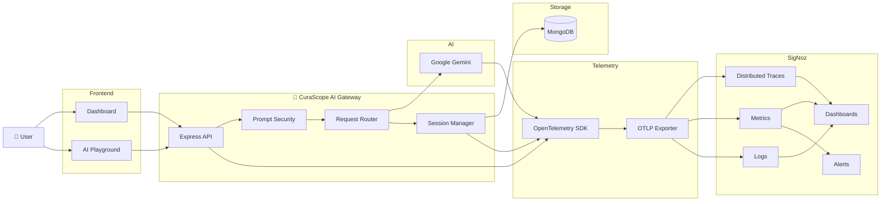
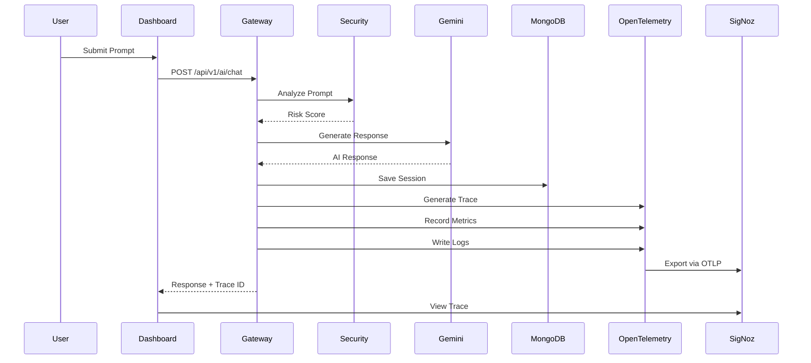
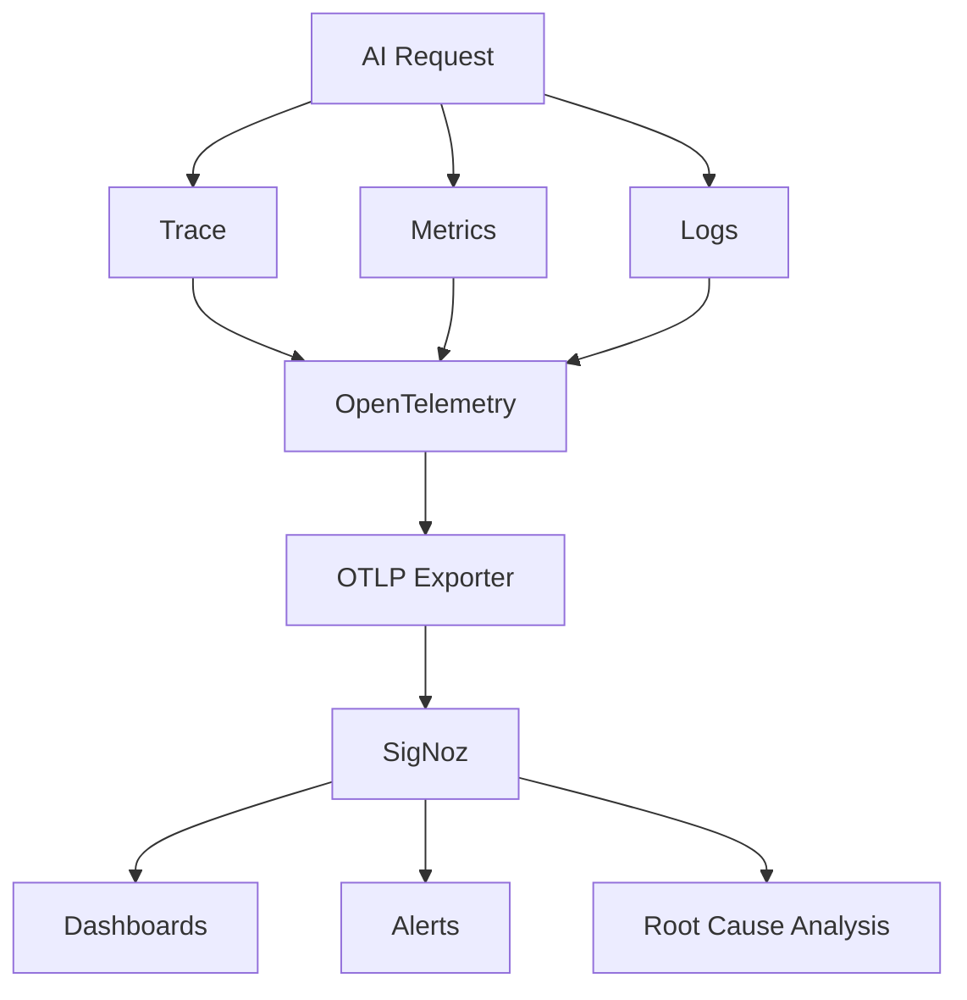
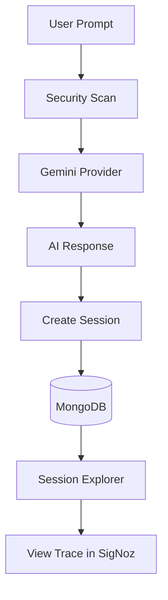

<div align="center">

#  CuraScope

### AI Gateway with End-to-End Observability for Production AI Applications

Observe Every Prompt. Trace Every Token. Secure Every Request.

<p align="center">


</p>

---

###  Live Demo

> **Coming Soon**


</div>

---

#  Overview

CuraScope is a production-ready AI Gateway designed to bring observability, security, and operational visibility to AI-powered applications.

Instead of treating AI as a black box, CuraScope captures every request, traces every execution, records performance metrics, estimates AI cost, analyzes prompt security, and exports telemetry to SigNoz using OpenTelemetry.

Developers can monitor every AI interaction through a unified dashboard while debugging failures using distributed traces, logs, metrics, alerts, and session analytics.

---

#  Why CuraScope?

Traditional monitoring platforms were built for microservices.

Modern AI applications require visibility into prompts, token usage, latency, model behavior, AI costs, security risks, and end-to-end execution.

CuraScope bridges this gap by combining an AI Gateway with production-grade observability built on OpenTelemetry and SigNoz.

#  Key Features

##  AI Gateway

- Unified interface for AI model interactions
- Gemini integration
- Provider abstraction layer
- Centralized request processing

---

##  Prompt Security

- Prompt risk analysis
- Security scoring
- Risk classification
- Prompt validation

---

##  AI Observability

- Distributed Tracing
- Metrics
- Logs
- OpenTelemetry Instrumentation
- SigNoz Integration

---

##  AI Analytics

- Gateway latency
- Token usage
- Estimated AI cost
- Request statistics
- Session timeline

---

##  Monitoring

- Real-time dashboards
- Alerting
- Latency monitoring
- Error tracking
- Cost monitoring

---

##  Session Management

- Complete session history
- AI responses
- Prompt metadata
- Trace IDs
- Security reports

---

#  The Problem

AI applications are rapidly becoming production workloads, but observing them remains a major challenge.

Unlike traditional APIs, AI systems introduce new operational concerns:

-  Unpredictable response latency
-  Increasing token costs
-  Limited visibility into model execution
-  Prompt injection and unsafe inputs
-  Difficult root cause analysis
-  Lack of AI-specific monitoring

Traditional observability tools focus on infrastructure and microservices, but they don't understand AI requests, prompts, token consumption, or model behavior.

Developers often have no answer to questions like:

- Which prompt caused this failure?
- Why did this request take 8 seconds?
- How many tokens were consumed?
- How much did this request cost?
- Which trace belongs to this AI session?
- Is someone attempting prompt injection?

---

#  Our Solution

CuraScope is an AI Gateway built specifically for modern AI applications.

Every request passes through a centralized gateway where it is validated, processed, instrumented, and exported to an observability platform.

Instead of treating AI as a black box, CuraScope makes every AI interaction transparent through traces, metrics, logs, dashboards, and alerts.

The platform automatically provides:

-  Prompt Security Analysis
-  AI Gateway Routing
-  AI Metrics
-  Token Analytics
-  Cost Estimation
-  Distributed Tracing
-  Structured Logging
-  Alerting
-  Session Analytics

---

#  System Architecture



---

#  Request Lifecycle

Every AI request follows the same execution pipeline.



---

#  Demo Walkthrough

1. Open the CuraScope dashboard.
2. Submit a prompt in the Chat Page.
3. The request passes through the AI Gateway.
4. Prompt security analysis is performed.
5. The request is sent to Gemini.
6. OpenTelemetry generates traces, metrics, and logs.
7. Telemetry is exported to SigNoz.
8. Explore the session in CuraScope or inspect the trace in SigNoz.
9. View dashboards and triggered alerts.

#  Design Goals

CuraScope was built around five core principles.

| Goal | Description |
|------|-------------|
|  Transparency | Observe every AI interaction end-to-end |
|  Performance | Measure latency, throughput, and response times |
|  Security | Detect unsafe prompts before execution |
|  Cost Awareness | Monitor token usage and estimated AI cost |
|  Observability | Provide traces, metrics, logs, dashboards, and alerts |

#  Tech Stack

CuraScope is built using a modern cloud-native technology stack designed for scalable AI applications and production observability.

| Layer | Technologies |
|--------|--------------|
| Frontend | React, Vite, TypeScript, Tailwind CSS |
| Backend | Node.js, Express.js, TypeScript |
| Database | MongoDB |
| AI Provider | Google Gemini 2.5 Flash |
| Observability | OpenTelemetry |
| Monitoring | SigNoz |
| Containerization | Docker |
| Package Manager | pnpm |
| Monorepo | Turborepo |

---

#  Project Structure

```text
curascope/
│
├── apps/
│   ├── dashboard/          # React Dashboard
│   └── server/             # AI Gateway Backend
│
├── packages/
│   ├── config/             # Shared configuration
│   ├── types/              # Shared TypeScript types
│   └── ui/                 # Shared UI components
│
├── docker/
│
├── docs/
│
├── .github/
│
├── package.json
├── turbo.json
└── pnpm-workspace.yaml
```

---

#  Observability Architecture

CuraScope instruments every AI request using OpenTelemetry and exports telemetry through the OTLP protocol to SigNoz.



---

#  Telemetry Captured

Every AI request automatically generates telemetry across multiple dimensions.

###  Traces

- End-to-end request execution
- Trace ID
- Span ID
- Provider execution
- Database operations
- AI processing timeline

###  Metrics

- Total AI Requests
- Gateway Latency
- Error Count
- Input Tokens
- Output Tokens
- Estimated AI Cost
- Security Requests

###  Logs

Business events generated during request execution:

```text
ai.request.received
security.scan.completed
provider.request.started
provider.response.received
database.session.saved
ai.request.completed
ai.request.failed
```

---

#  Prompt Security

Every prompt is analyzed before reaching the AI provider.

Current security capabilities include:

- Prompt validation
- Risk classification
- Security scoring
- Safe request routing

This ensures unsafe or suspicious prompts can be identified before model execution.

---

#  Session Management

Each AI interaction is stored as a session containing:

- User Prompt
- AI Response
- Model Used
- Provider
- Latency
- Token Usage
- Estimated Cost
- Security Risk
- Trace ID
- Span ID
- Timestamp

This enables complete replay and debugging of every AI interaction.

#  Session Flow


---

#  Dashboard Overview

The CuraScope dashboard provides real-time visibility into AI application performance.

Current dashboard includes:

- Total AI Requests
- P95 Gateway Latency
- AI Errors
- Estimated AI Cost
- Request Trends
- Latency Trends
- Token Analytics
- Error Trends
- Latency Distribution
- Session Explorer

---

#  Intelligent Alerting

CuraScope supports proactive monitoring through SigNoz alerts.

Example alerts include:

| Alert | Purpose |
|--------|---------|
| High Gateway Latency | Detect slow AI responses |
| AI Error Spike | Identify request failures |
| High AI Cost | Monitor token spending |
| No AI Traffic | Detect gateway inactivity |

These alerts help identify issues before they impact production workloads.

#  Getting Started

Follow the steps below to set up CuraScope locally.

## Prerequisites

Ensure the following tools are installed:

- Node.js (v20 or later)
- pnpm
- Docker & Docker Compose
- MongoDB
- Git

---

#  Installation

Clone the repository

```bash
git clone https://github.com/<your-username>/curascope.git
```

Navigate to the project

```bash
cd curascope
```

Install dependencies

```bash
pnpm install
```

---

#  Environment Variables

Create a `.env` file inside `apps/server`.

```env
PORT=5000

MONGODB_URI=your_mongodb_connection_string

GEMINI_API_KEY=your_gemini_api_key

APP_NAME=CuraScope

OTEL_EXPORTER_OTLP_ENDPOINT=http://localhost:4318

OTEL_EXPORTER_OTLP_PROTOCOL=http/protobuf

OTEL_LOGS_EXPORTER=otlp

OTEL_EXPORTER_OTLP_LOGS_PROTOCOL=http/protobuf

OTEL_EXPORTER_OTLP_HEADERS=
```

Create a `.env` file inside `apps/dashboard`.

```env
VITE_SIGNOZ_URL=http://localhost:8080
```

---

#  Running SigNoz

Deploy SigNoz locally using Docker.

```bash
curl -fsSL https://signoz.io/install.sh | sh
```

or using Foundry

```bash
foundryctl cast -f casting.yaml
```

After deployment, open

```
http://localhost:8080
```

---

#  Running the Project

Start all applications

```bash
pnpm dev
```

This starts:

- Dashboard
- AI Gateway Server

---

#  Application URLs

| Service | URL |
|----------|-----|
| Dashboard | http://localhost:5173 |
| Backend API | http://localhost:5000 |
| SigNoz | http://localhost:8080 |

---

#  API Example

### Chat Request

```http
POST /api/v1/ai/chat
```

Request

```json
{
  "prompt": "Explain quantum computing in simple terms."
}
```

Response

```json
{
  "success": true,
  "sessionId": "...",
  "response": "...",
  "latency": 2150,
  "traceId": "...",
  "spanId": "..."
}
```

---

# 📸 Screenshots

## Landing Page

> Add screenshot here

---

## AI Chat Page

> Add screenshot here

---

## Dashboard

> Add screenshot here

---

## Session Explorer

> Add screenshot here

---

## SigNoz Dashboard

> Add screenshot here

---

## Distributed Trace

> Add screenshot here

---

## Alerting

> Add screenshot here

---

#  Roadmap

## Current Features

- [x] AI Gateway
- [x] Gemini Integration
- [x] Prompt Security
- [x] Session Management
- [x] OpenTelemetry Instrumentation
- [x] Distributed Tracing
- [x] Metrics
- [x] Structured Logging
- [x] SigNoz Integration
- [x] Dashboards
- [x] Alerting

## Upcoming Features

- [ ] Multi-provider AI Support
- [ ] AI Request Replay
- [ ] Prompt Versioning
- [ ] Cost Analytics Dashboard
- [ ] Kubernetes Deployment
- [ ] Authentication & RBAC
- [ ] Webhook Notifications
- [ ] Team Workspaces

---

#  Contributing

Contributions are welcome!

1. Fork the repository.
2. Create a feature branch.
3. Commit your changes.
4. Push your branch.
5. Open a Pull Request.

Please ensure your code follows the project's formatting and linting standards.

---

#  License

This project is licensed under the MIT License.

See the `LICENSE` file for more information.

---

#  Acknowledgements

CuraScope is built using several amazing open-source technologies.

- OpenTelemetry
- SigNoz
- React
- Node.js
- Express.js
- MongoDB
- Docker
- Turborepo
- Google Gemini

Special thanks to the open-source community for making production-grade AI infrastructure accessible to developers.

---
